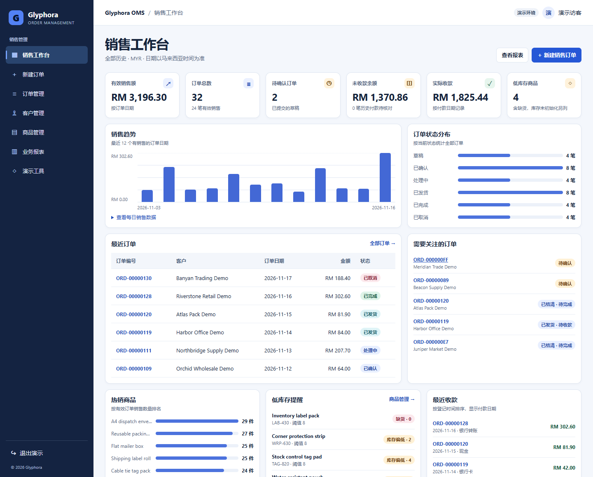
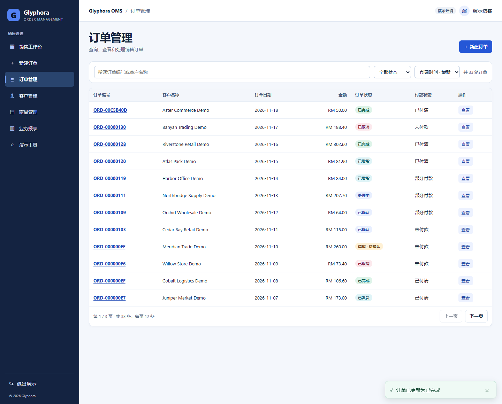
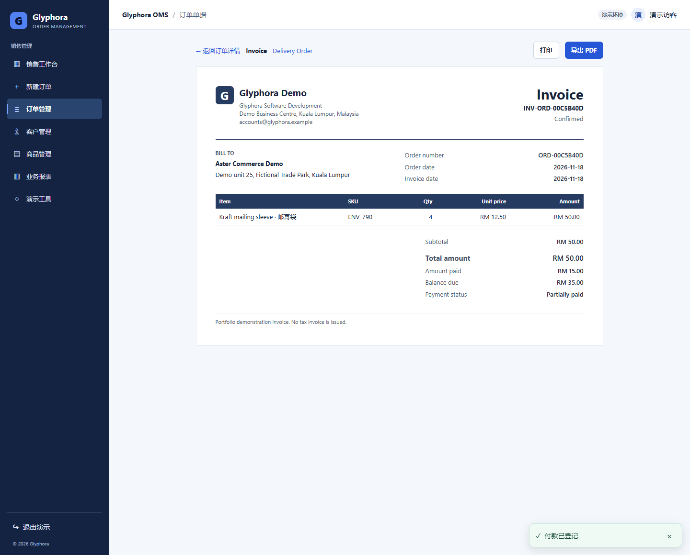
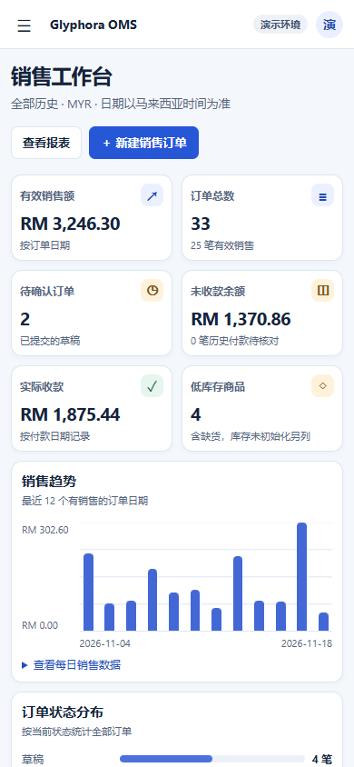

# Glyphora OMS

**Glyphora Software Development · Portfolio Demo**

Glyphora OMS is a browser-based order management workspace for small distribution and sales teams. The demo shows one connected workflow from customer and product records through orders, payment, shipping, documents, and reporting. The sample companies, contacts, transactions, and receipts are fictional.

## Screenshots

| Dashboard | Orders |
| --- | --- |
|  |  |

| Invoice | Mobile |
| --- | --- |
|  |  |

## Features

- Dashboard with sales, receipts, outstanding balances, pending orders, and stock alerts.
- Customer and product management, order search, status filters, sorting, and pagination.
- Draft → Confirmed → Processing → Shipped → Completed lifecycle, cancellation, and an order timeline.
- Stock deduction on confirmation, inventory adjustments, and movement history. Eligible pre-shipment cancellations restore recorded stock.
- Partial and full receipt recording, duplicate operation protection, and balance computed from posted receipts.
- Invoice and Delivery Order previews, bilingual item text, A4 printing, and PDF export.
- Sales, receipts, receivables, and inventory reports with explicit date and status rules.
- Responsive navigation, keyboard-operable dialogs, and a local demo reset.

## Technology

React, TypeScript, Vite, React Router, CSS, and IndexedDB. jsPDF and html2canvas power the on-demand PDF download. Node's test runner, fake-indexeddb, and Playwright Core are used for verification.

## Run locally

Use Node.js 24.

```sh
npm ci
npm run dev
npm run build
npm run lint
npm test
npm run test:browser
```

The browser suite uses Microsoft Edge by default. For additional targets, run `npx playwright-core install chromium firefox` and set `OMS_BROWSER` to `chrome` (Chrome for Testing) or `firefox` (Playwright's Firefox build). Tests use an isolated browser context and a temporary loopback server. Set `OMS_PORTFOLIO_DIR`, `OMS_SCREENSHOTS_DIR`, or `OMS_PDF_DIR` to retain screenshots and PDFs.

## Try the demo

1. Open the URL printed by Vite and select **进入演示**. Employee credentials are unnecessary.
2. A pristine workspace receives 12 customers, 20 products, 32 orders, 20 receipts, and 97 stock movements. Four products are low or out of stock.
3. Browse customers and products. Create an order with an in-stock item such as **BOX-100**, submit it, then confirm to deduct inventory.
4. Post a partial receipt, mark the order Processing and Shipped, record the remaining receipt, and complete the order.
5. Open Invoice and Delivery Order from the order details. Check the updated totals in **业务报表**.
6. Use **演示工具 → 重置演示数据** to restore the sample data after confirming. Reset replaces edits made inside the seeded demo workspace. Previously stored local or migrated OMS records are protected. Migration errors are shown with the original data retained.

The demo entry stays active when the current tab reloads. First-time visitors can enter from a direct order, report, or document link and continue at that address. **退出演示** clears the tab's entry state without clearing the stored workspace.

## Cloudflare Pages

Deploy the repository root with the Vite preset, build command `npm run build`, output directory `dist`, production branch `main`, and `NODE_VERSION=24`. Serve the site at the root of its HTTPS hostname.

Vite copies `public/_redirects` and `public/404.html` into the deployment output. Known application routes use internal HTTP 200 rewrites to `/`, which serves `index.html` while preserving the requested URL. Unmatched paths, including missing assets, return HTTP 404. In a Pages preview, verify direct links and refresh, an existing JavaScript asset with a JavaScript content type, and a missing asset with status 404.

## Architecture and data rules

- `commerceRepository.ts` stores a schema-version-3 document in IndexedDB. Each command reads the latest document and commits changes in one read-write transaction. Order state, timeline, payments, stock, and movements share that boundary.
- `orderStorage.ts` and `commerceRules.ts` enforce payment limits, legal transitions, stock availability, and operation idempotency. Order prices, quantities, SKU, and saved customer details are snapshotted.
- `demoSeed.ts` generates reproducible fictional records through the same business commands. `demoLifecycle.ts` rechecks ownership inside the IndexedDB transaction. Seeded workspaces keep their customer records in that document so a complete reset commits atomically. Legacy customer records keep their existing browser storage.
- Original V1/V2 sources and migration backups are preserved. Missing historical addresses, SKU, shipment dates, or recorded payments remain distinguishable from verified values.
- `reportModel.ts` supplies the Dashboard and Reports. Effective sales use order date and exclude drafts and cancellations. Receipts use payment date. Receivables use effective orders minus all posted receipts, with unresolved historical amounts shown separately. Stock movements use Malaysia business dates.

## Portfolio scope and limits

This demo uses browser isolation per site origin and browser profile. Shared accounts, server synchronization, payment gateways, refunds, returns, and production tax invoicing are outside its scope. Use fictional entries. Clearing browser site data can remove the local workspace.

PDF downloads rasterize the layout to preserve Chinese and English glyphs. Choose **打印** and the browser's Save as PDF option for selectable text. Android hardware verification is pending. Desktop browsers were exercised at 390, 768, 1280, and 1920 CSS pixels.

## Tauri desktop application

The desktop application wraps the same OMS V2 React workspace. Its orders, receipts, inventory, documents and reports use the existing browser storage layer inside the system WebView. Desktop and hosted Web workspaces have independent local data.

Install Rust 1.90 or newer, the Windows C++ build tools and WebView2, then run:

```sh
npm ci
npm run tauri dev
npm run tauri build
```

The Tauri development window uses http://localhost:5173. Vite keeps that port fixed. Release assets come from dist. Native PDF download and printing require validation in the packaged WebView in addition to the browser tests.
